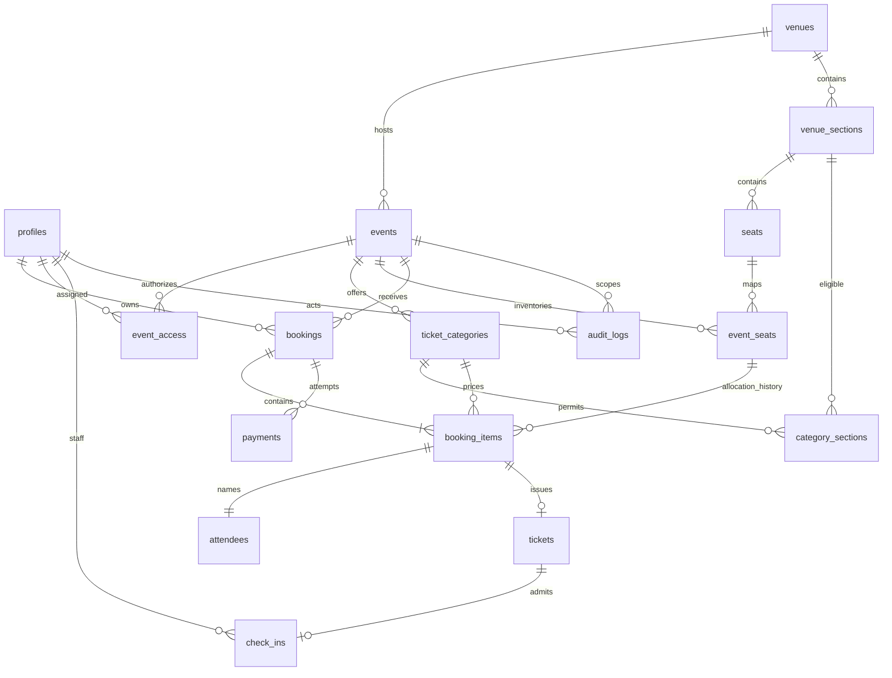

# Database dan ERD

Proposal konseptual; SQL migrations dibuat setelah persetujuan. Semua PK UUID kecuali inventory memakai composite key. Timestamps UTC, uang bigint IDR nonnegative. FK historis RESTRICT; event diarchive, booking/tiket tidak dihapus melalui UI.

## Entitas dan kolom utama
| Tabel | Kolom/constraint utama |
|---|---|
| profiles | id FK auth.users, display_name; privileged role dikelola server |
| event_access | event_id, user_id, role ORGANIZER/STAFF; unique ketiganya |
| venues | id, name, address, timezone |
| venue_sections | id, venue_id, name, layout; unique venue/name |
| seats | id, section_id, row_label, number, x/y; unique section/row/number |
| events | id, venue_id, slug unique, title, poster, description, rules, starts_at, ends_at, status DRAFT/PUBLISHED/UNPUBLISHED/ARCHIVED |
| ticket_categories | id, event_id, name, price_idr, quota, sales_start/end |
| category_sections | category_id, section_id composite PK; venue harus cocok |
| event_seats | event_id, seat_id composite PK; stable row untuk locking dan availability |
| bookings | id, reference unique, user_id, event_id, status, expires_at, subtotal_idr, fee_idr, total_idr, idempotency_key; unique user/key |
| booking_items | id, booking_id, event_id, seat_id, category_id, price_snapshot_idr, allocation_status; unique booking/seat |
| attendees | id, booking_item_id unique, display_name; data kontak pada booking/profile sesuai kebutuhan |
| payments | id, booking_id, status, amount_idr, simulation_key unique, confirmed_at; maksimal satu paid per booking |
| tickets | id, reference unique, booking_item_id unique, token_hash unique, token_ciphertext, key_version, status, issued_at |
| check_ins | id, ticket_id unique, event_id, staff_id, checked_in_at |
| audit_logs | id, actor_id nullable untuk sistem, event_id, action, entity_id, safe_metadata, created_at |

Semua tabel memiliki created_at; mutable tables juga updated_at. Composite FK/check melalui RPC/trigger menjamin seat sesuai venue event, kategori sesuai event, section eligible, check-in sesuai event tiket. Index: event status/starts_at, bookings user/created_at dan event/status/expiry, items event/seat, payments booking/status, access user/event, audit event/created_at. Foreign keys diberi index sesuai pola query.

## State dan transaksi
Booking: PENDING_PAYMENT → CONFIRMED / FAILED / EXPIRED / CANCELLED. Payment: PENDING → PAID / FAILED / EXPIRED. Allocation: RESERVED → SOLD / RELEASED. Ticket: ACTIVE → REVOKED; check-in merupakan catatan terpisah, tidak reset otomatis.

reserve_booking mengunci event/category (urutan ID tetap) lalu event_seats terurut untuk mencegah deadlock. Di dalam transaksi, release hold expired yang konflik, cek sales window/venue/category/kuota/sisa inventory dan seluruh kursi, hitung harga server, kemudian insert booking/items/attendees/payment. Kesalahan satu kursi rollback semua. Partial unique index (event_id, seat_id) WHERE allocation_status IN ('RESERVED','SOLD') mencegah dua allocation aktif. Jangan gunakan now() dalam predicate index. Availability mengabaikan RESERVED dengan expires_at <= waktu server; transaksi berikutnya membersihkan record expired sebelum insert. Kuota termasuk sold + hold belum expired dan diserialisasi melalui lock kategori.

confirm_simulated_payment mengunci booking lalu kategori/inventory konsisten; return hasil existing jika sudah confirmed. Jika expired, release allocation dan commit hasil EXPIRED. Jika eligible, update paid/confirmed/SOLD dan issue satu ticket per item dalam transaksi yang sama. Unique item dan paid constraint mencegah issuance/payment ganda. Failure melepas inventory. Expiry scheduler idempotent hanya mempercepat cleanup, bukan sumber kebenaran. Race payment-expiry-reserve harus menggunakan lock order yang sama di seluruh RPC.

confirm_check_in memeriksa assignment, hash token/reference, payment paid, booking confirmed, status ticket dan event, lalu insert check_ins dengan unique ticket_id; konflik menjadi ALREADY_USED. Preview tidak menulis check-in. UNPAID didukung defensif untuk record inconsistent/imported; alur normal tidak menerbitkan tiket unpaid.

## Akses dan privasi
RLS seluruh exposed tables. Public membaca katalog published dan geometry/availability tanpa PII melalui view/RPC terbatas. Pemilik membaca booking/items/attendees/payment/ticket sendiri. Organizer membaca/mengelola scope assigned; perubahan inventory hanya melalui RPC tervalidasi. Staff hanya RPC lookup/check-in assigned event. event_access dan role tidak dapat diubah user sendiri. Audit hanya append melalui server; tidak menaruh token/contact dalam metadata. Auth user deletion tidak cascade menghapus transaksi; kebijakan anonymization/retention final perlu diputuskan sebelum penggunaan nyata.

## Database foundation yang sudah diimplementasikan
Migrasi 202611030001_foundation.sql hanya membuat profiles, venues, events, event_access, venue_sections, seats, ticket_categories dan category_sections. Relasi venue kategori/section diperkuat composite FK. RLS aktif pada seluruh delapan tabel. Penulisan katalog dan assignment oleh klien belum diberi grant. Profil hanya boleh dibaca pemilik dan diubah kolom display_name. Event draft terlihat hanya bagi akun assigned. Trigger auth.users membuat profil tanpa mengambil role dari metadata pengguna. Model booking/payment/ticket pada proposal di atas belum menjadi tabel aktif pada tahap ini.

Pengujian lokal PGlite menjalankan migrasi sebenarnya, seed dua kali, role anon/authenticated dan tiga identitas. Shim auth.uid memakai request.jwt.claim.sub. Ini memverifikasi SQL/RLS foundation, tetapi tidak menggantikan pengujian integrasi terhadap Supabase Auth remote.

## Reservasi yang sudah diimplementasikan
Migrasi kedua menambahkan event_seats (event/seat composite PK + revision), bookings (user/event/category/expiry/status/price snapshot/idempotency), booking_items (allocation history + partial unique active event/seat), attendees (nama per item). RLS dan grant membatasi baca pemilik/organizer assigned; staff tidak memiliki akses direktori booking. Reserve dan cancel mengunci row event terlebih dahulu, sehingga operasi event diserialisasi. Perubahan harga/kuota dan payment di fase berikutnya wajib mengikuti lock yang sama. Expired hold diabaikan oleh availability dan direlease sebelum insert baru. Fungsi get_booking/my_bookings tidak memuat data pemilik lain. Semua monetary values integer IDR.

## Pembayaran dan tiket yang diimplementasikan
Migrasi003 menambahkan payments (booking unique, integer amount, status dan confirmed_at), tickets (booking_item unique, reference unique, token_hash unique, status/issued_at), serta ticket_secrets (ticket PK, encrypted_token, key_version). Token mentah tidak disimpan. RLS pada ketiganya; ciphertext tanpa akses browser. Payment trigger menangani booking baru dan expiry/cancel/failure; require_paid_ticket memastikan issuance hanya untuk booking confirmed, payment paid dengan amount cocok dan allocation SOLD. RPC issuer/read ciphertext hanya service_role dan dipanggil setelah authorization server. Detail ada di PAYMENTS_TICKETS.md.
