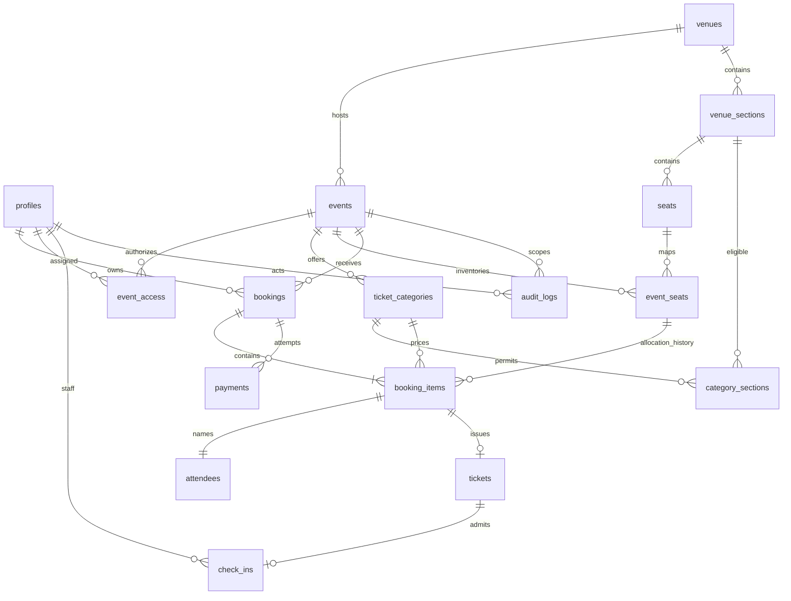

# Database dan ERD

Proposal konseptual; SQL migrations dibuat setelah persetujuan. Semua PK UUID kecuali inventory memakai composite key. Timestamps UTC, uang bigint IDR nonnegative. FK historis RESTRICT; event diarchive, booking/tiket tidak dihapus melalui UI.

## Entitas dan kolom utama
| Tabel | Kolom/constraint utama |
|---|---|
| profiles | id FK auth.users, display_name; privileged role dikelola server |
| event_access | event_id, user_id, role ORGANIZER/STAFF; unique ketiganya |
| venues | id, name, address, timezone |
| venue_sections | id, venue_id, name, layout; unique venue/name |
| seats | id, section_id, row_label, number, x/y; unique section/row/number |
| events | id, venue_id, slug unique, title, poster, description, rules, starts_at, ends_at, status DRAFT/PUBLISHED/UNPUBLISHED/ARCHIVED |
| ticket_categories | id, event_id, name, price_idr, quota, sales_start/end |
| category_sections | category_id, section_id composite PK; venue harus cocok |
| event_seats | event_id, seat_id composite PK; stable row untuk locking dan availability |
| bookings | id, reference unique, user_id, event_id, status, expires_at, subtotal_idr, fee_idr, total_idr, idempotency_key; unique user/key |
| booking_items | id, booking_id, event_id, seat_id, category_id, price_snapshot_idr, allocation_status; unique booking/seat |
| attendees | id, booking_item_id unique, display_name; data kontak pada booking/profile sesuai kebutuhan |
| payments | id, booking_id, status, amount_idr, simulation_key unique, confirmed_at; maksimal satu paid per booking |
| tickets | id, reference unique, booking_item_id unique, token_hash unique, token_ciphertext, key_version, status, issued_at |
| check_ins | id, ticket_id unique, event_id, staff_id, checked_in_at |
| audit_logs | id, actor_id nullable untuk sistem, event_id, action, entity_id, safe_metadata, created_at |

Semua tabel memiliki created_at; mutable tables juga updated_at. Composite FK/check melalui RPC/trigger menjamin seat sesuai venue event, kategori sesuai event, section eligible, check-in sesuai event tiket. Index: event status/starts_at, bookings user/created_at dan event/status/expiry, items event/seat, payments booking/status, access user/event, audit event/created_at. Foreign keys diberi index sesuai pola query.

## State dan transaksi
Booking: PENDING_PAYMENT → CONFIRMED / FAILED / EXPIRED / CANCELLED. Payment: PENDING → PAID / FAILED / EXPIRED. Allocation: RESERVED → SOLD / RELEASED. Ticket: ACTIVE → REVOKED; check-in merupakan catatan terpisah, tidak reset otomatis.

reserve_booking mengunci event/category (urutan ID tetap) lalu event_seats terurut untuk mencegah deadlock. Di dalam transaksi, release hold expired yang konflik, cek sales window/venue/category/kuota/sisa inventory dan seluruh kursi, hitung harga server, kemudian insert booking/items/attendees/payment. Kesalahan satu kursi rollback semua. Partial unique index (event_id, seat_id) WHERE allocation_status IN ('RESERVED','SOLD') mencegah dua allocation aktif. Jangan gunakan now() dalam predicate index. Availability mengabaikan RESERVED dengan expires_at <= waktu server; transaksi berikutnya membersihkan record expired sebelum insert. Kuota termasuk sold + hold belum expired dan diserialisasi melalui lock kategori.

confirm_simulated_payment mengunci booking lalu kategori/inventory konsisten; return hasil existing jika sudah confirmed. Jika expired, release allocation dan commit hasil EXPIRED. Jika eligible, update paid/confirmed/SOLD dan issue satu ticket per item dalam transaksi yang sama. Unique item dan paid constraint mencegah issuance/payment ganda. Failure melepas inventory. Expiry scheduler idempotent hanya mempercepat cleanup, bukan sumber kebenaran. Race payment-expiry-reserve harus menggunakan lock order yang sama di seluruh RPC.

confirm_check_in memeriksa assignment, hash token/reference, payment paid, booking confirmed, status ticket dan event, lalu insert check_ins dengan unique ticket_id; konflik menjadi ALREADY_USED. Preview tidak menulis check-in. UNPAID didukung defensif untuk record inconsistent/imported; alur normal tidak menerbitkan tiket unpaid.

## Akses dan privasi
RLS seluruh exposed tables. Public membaca katalog published dan geometry/availability tanpa PII melalui view/RPC terbatas. Pemilik membaca booking/items/attendees/payment/ticket sendiri. Organizer membaca/mengelola scope assigned; perubahan inventory hanya melalui RPC tervalidasi. Staff hanya RPC lookup/check-in assigned event. event_access dan role tidak dapat diubah user sendiri. Audit hanya append melalui server; tidak menaruh token/contact dalam metadata. Auth user deletion tidak cascade menghapus transaksi; kebijakan anonymization/retention final perlu diputuskan sebelum penggunaan nyata.

## Database foundation yang sudah diimplementasikan
Migrasi 202611030001_foundation.sql hanya membuat profiles, venues, events, event_access, venue_sections, seats, ticket_categories dan category_sections. Relasi venue kategori/section diperkuat composite FK. RLS aktif pada seluruh delapan tabel. Penulisan katalog dan assignment oleh klien belum diberi grant. Profil hanya boleh dibaca pemilik dan diubah kolom display_name. Event draft terlihat hanya bagi akun assigned. Trigger auth.users membuat profil tanpa mengambil role dari metadata pengguna. Model booking/payment/ticket pada proposal di atas belum menjadi tabel aktif pada tahap ini.

Pengujian lokal PGlite menjalankan migrasi sebenarnya, seed dua kali, role anon/authenticated dan tiga identitas. Shim auth.uid memakai request.jwt.claim.sub. Ini memverifikasi SQL/RLS foundation, tetapi tidak menggantikan pengujian integrasi terhadap Supabase Auth remote.

## Reservasi yang sudah diimplementasikan
Migrasi kedua menambahkan event_seats (event/seat composite PK + revision), bookings (user/event/category/expiry/status/price snapshot/idempotency), booking_items (allocation history + partial unique active event/seat), attendees (nama per item). RLS dan grant membatasi baca pemilik/organizer assigned; staff tidak memiliki akses direktori booking. Reserve dan cancel mengunci row event terlebih dahulu, sehingga operasi event diserialisasi. Perubahan harga/kuota dan payment di fase berikutnya wajib mengikuti lock yang sama. Expired hold diabaikan oleh availability dan direlease sebelum insert baru. Fungsi get_booking/my_bookings tidak memuat data pemilik lain. Semua monetary values integer IDR.

## Pembayaran dan tiket yang diimplementasikan
Migrasi003 menambahkan payments (booking unique, integer amount, status dan confirmed_at), tickets (booking_item unique, reference unique, token_hash unique, status/issued_at), serta ticket_secrets (ticket PK, encrypted_token, key_version). Token mentah tidak disimpan. RLS pada ketiganya; ciphertext tanpa akses browser. Payment trigger menangani booking baru dan expiry/cancel/failure; require_paid_ticket memastikan issuance hanya untuk booking confirmed, payment paid dengan amount cocok dan allocation SOLD. RPC issuer/read ciphertext hanya service_role dan dipanggil setelah authorization server. Detail ada di PAYMENTS_TICKETS.md.

## Katalog dan Storage pada migrasi006 dan007

Events menambahkan organizer_name, area, theme, headline dan cover_url. public_catalog hanya mengembalikan PUBLISHED; organizer_event dan manage_event memeriksa penugasan ORGANIZER. manage_event mengunci row event sebelum memeriksa booking/kuota dan mengubah event/kategori/inventori. Audit_logs menyimpan relasi event_id ke events, actor_id ke profiles, action, before_data, after_data dan created_at; organizer assigned hanya mendapat hak SELECT. Client tidak dapat menulis audit langsung.

Tickets menambahkan event_snapshot JSONB, diisi trigger sebelum penerbitan dan dibaca lewat RPC owner-only. Tiket lama dibackfill dari metadata yang tersedia pada saat migrasi. Harga tetap berasal dari booking_items.price_snapshot_idr. Snapshot dapat dibaca pemilik walaupun event unpublished/archived.

Storage bucket event-covers tetap privat, batas WebP5MB. Objek berformat eventUUID/fileUUID.webp. Kebijakan read mengizinkan organizer assigned atau cover current dari event PUBLISHED; insert hanya organizer assigned pada event nonarsip; delete hanya objek yang tidak direferensikan sebagai cover current. Tidak ada UPDATE objek. Trigger require_cover_object menolak linking cover yang belum diupload. Rincian setup dan bukti pengujian ada di SUPABASE_INTEGRATION.md.

## Denah fleksibel pada migrasi 010

Events menambahkan seating_version (optimistic concurrency), seating_managed (konfigurasi API baru), seating_width dan seating_height. Venue_sections menambahkan event_id nullable dengan FK komposit (event_id,venue_id) ke events. Section lama tetap shared; section custom dimiliki satu event. Partial unique indexes memisahkan nama shared per venue dan nama custom per event. Trigger pada event_seats/category_sections menolak pemetaan section custom milik event lain. RLS section draft custom mengikuti visibilitas event, sehingga tidak bocor melalui venue yang memiliki event publik.

Ticket_categories menambahkan is_active. Bookings menambahkan category_name_snapshot, diisi trigger saat reservasi dan dibaca pada booking serta e-ticket. Harga historis tetap di booking_items.price_snapshot_idr. Denah custom tidak dapat diganti setelah ada riwayat booking sehingga seat ID dan label lama tetap stabil.

Fungsi konfigurasi mengunci row event seperti reservasi dan pembayaran. GET hanya organizer assigned; PUT layout serta create/update kategori merupakan transaksi tunggal yang mengaudit before/after. Section/kategori baru tidak dapat ditulis langsung oleh browser. Penjelasan batas kuota, periode jual, lock, migrasi, serta kontrak API ada di [SEATING_API.md](SEATING_API.md).

## Notifikasi dan outbox pada migrasi 011

Notifications menghubungkan user_id ke profiles, event_id ke events, booking_id ke bookings serta ticket_id opsional ke tickets. Dedup_key unik mencegah pengulangan logical event. Index(user_id,created_at desc,id desc) mendukung daftar/cursor. Read_at dan dismissed_at menyimpan status baca serta soft clear tanpa menghapus dedup atau riwayat email.

Notification_preferences menyimpan pilihan pengingat per user. Notification_outbox memiliki FK notification_id unik, state PENDING/PROCESSING/RETRY/SENT/FAILED/SKIPPED, attempts maksimal5, waktu retry dan lease, payload immutable, ID provider serta kode error. Index(status,next_attempt_at,lease_until) dipakai worker. Browser tidak memiliki hak akses outbox. RLS notifikasi/preferensi hanya pemilik, tanpa write grants langsung.

Trigger booking membuat notifikasi reservasi dan outbox tiket sesudah status confirmed, dalam transaksi yang sama dengan perubahan booking. Trigger event membuat pemberitahuan perubahan judul/jadwal/lokasi bagi pemesan confirmed. Scheduler mengikuti lock event terlebih dahulu seperti payment/reservasi. RPC kirim ulang mengunci event lalu profil untuk pemeriksaan per-akun rate limit tanpa membalik urutan lock transaksi.

Worker-only RPC memakai service_role: scheduler, claim maksimal5 dengan SKIP LOCKED dan lease5menit, context revalidation, freeze payload, dan ack dengan lease token. RPC pengguna tidak menerima ID pemilik. Pembatasan email, preferences, retry/idempotency dan panduan staging ada di [NOTIFICATIONS.md](NOTIFICATIONS.md).

## Lampiran PDF pada migrasi 012

Struktur tabel tidak berubah. prepare_notification_email menerima envelope terenkripsi versi2 sampai3MB dengan metadata ticketIds maksimal6. notification_email_context menambahkan kind/bookingId/ticketId dan memeriksa seluruh tiket lampiran tetap aktif serta milik booking/pemilik job. notification_attachment_tickets hanya dapat dipanggil service_role dengan lease yang valid dan mengembalikan record tiket aktif dari booking job atau satu tiket saat resend. notification_pdf_configuration dipakai preflight sebelum worker melakukan claim. Detail keamanan, kompatibilitas payload lama dan aktivasi ada di TICKET_PDF_EMAIL.md.

## Operasional backend, migrasi 013 sampai 015

`staff_invitations` menyimpan event, email tujuan, inviter, expiry, status dan idempotency key. Tidak ada grant browser langsung; RPC memeriksa organizer atau email Auth terverifikasi penerima. Index unik pending per event/email, index email/status, dan unique inviter/request key menjaga dedup.

`notifications` menambahkan invitation_id; owner dan booking boleh kosong hanya pada kind STAFF_INVITED. Kind baru BOOKING_EXPIRED dan EVENT_CANCELLED memakai outbox yang sama. Penerimaan undangan menghubungkan notifikasi ke akun penerima. `events` menambahkan cancelled_at/cancellation_reason/cancellation_key dengan constraint kelengkapan. Status pembayaran historis tidak diubah menjadi refund. Scheduler membersihkan expiry dengan event lock dan bounded batch.

`notification_receipts` menyimpan webhook ID unik, provider ID, jenis event dan waktu, tanpa body/PII provider. RLS aktif, tidak ada akses langsung browser. Status delivery dihitung melalui provider ID agar receipt sebelum ack tetap terbaca. RPC operasi antrean hanya metadata event assigned. Retry tidak mereset attempts, payload atau first_attempt_at.

Seluruh helper serializer/RPC lama yang dibungkus dicabut akses langsungnya. Migration 015 menyelaraskan lock assignment/check-in; assignment ditinjau ulang setelah memperoleh event lock. Lihat [BACKEND_OPERATIONS.md](BACKEND_OPERATIONS.md) untuk kontrak, aktivasi dan acceptance staging.
