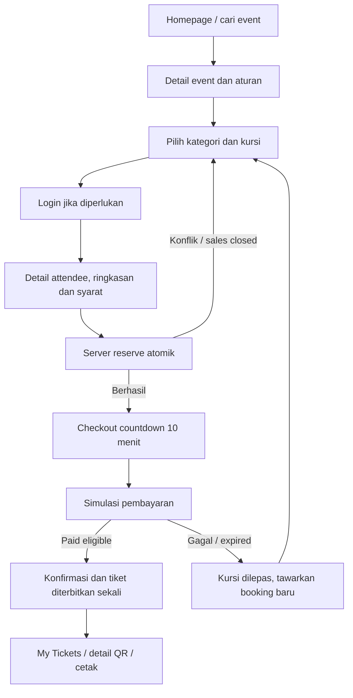
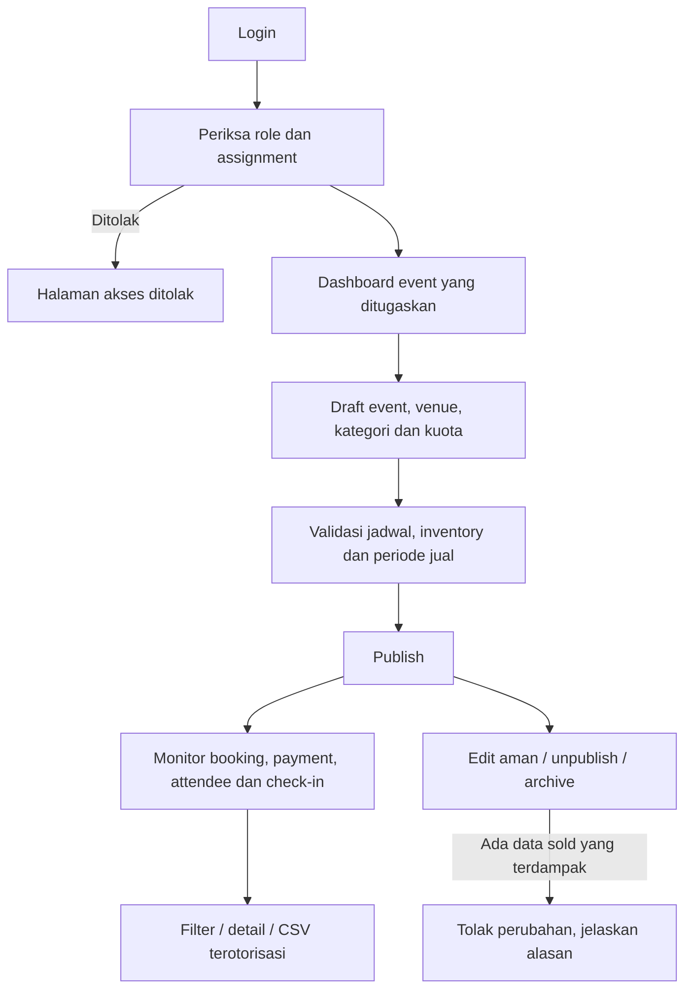
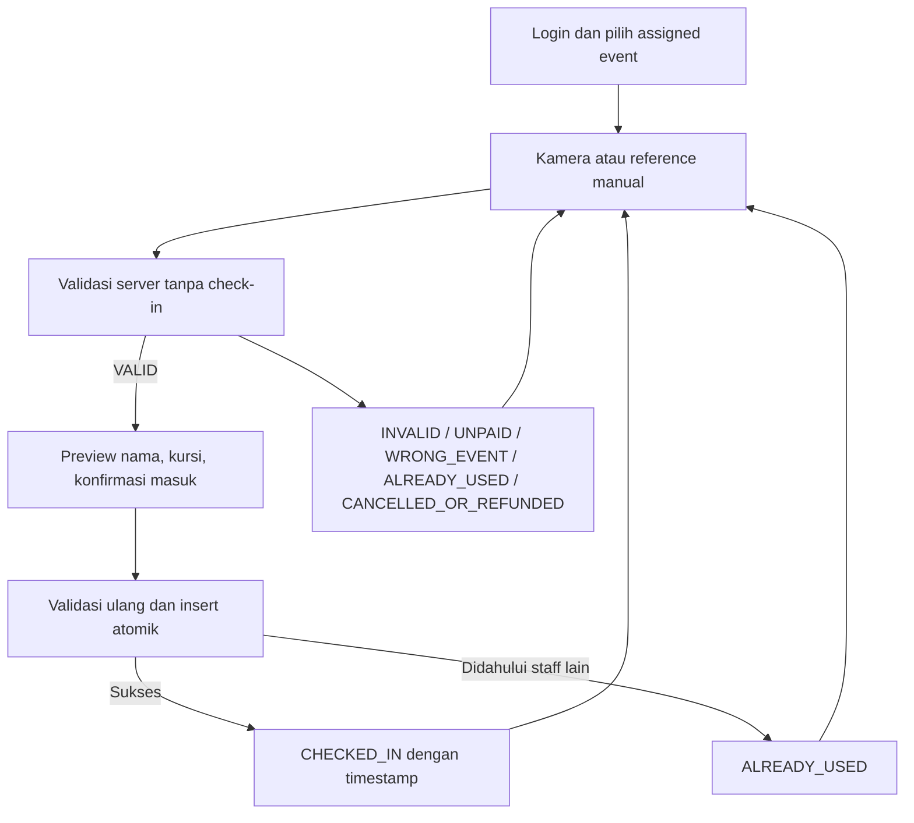

# User flows

## Attendee

Kembali dari login mempertahankan pilihan lokal, tetapi availability diperiksa ulang. Refresh checkout memuat booking dan expiry dari server. Putus jaringan saat payment: baca hasil transaksi sebelum retry. Konflik kursi menjelaskan kursi yang tidak tersedia dan memuat ulang peta. Countdown habis menonaktifkan pembayaran dan mengambil status server.

## Organizer

Publish mensyaratkan venue, kategori eligible, harga dan jadwal valid. CSV mengikuti event/filter yang diizinkan, hanya kolom perlu, escape formula spreadsheet. Konfirmasi eksplisit untuk archive/unpublish.

## Staff

Permission kamera ditolak/unsupported → input manual. Kamera berhenti saat navigasi/scan selesai. Offline tidak boleh menampilkan sukses; staff retry setelah jaringan pulih. INVALID tidak mengungkap data pemilik; WRONG_EVENT hanya tersedia kepada staff yang terautentikasi. Preview bukan jaminan masuk sampai konfirmasi atomik selesai.
